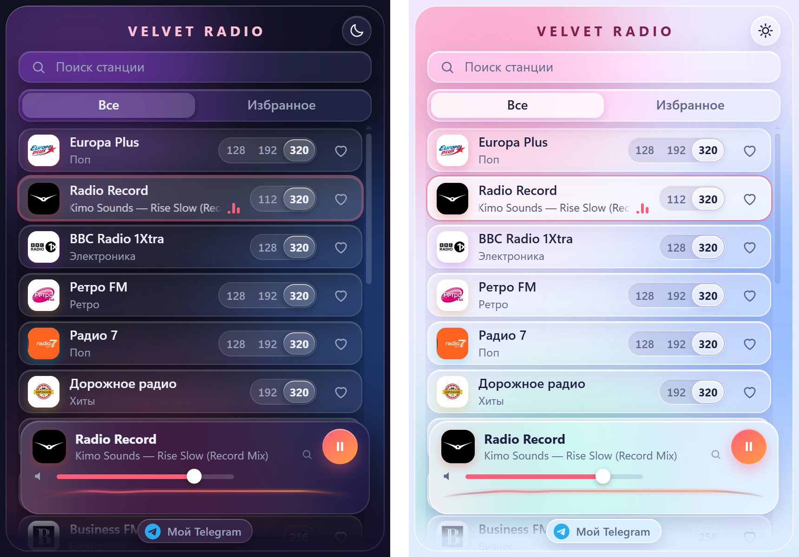

# Velvet Radio

**Радио России и мира для Chrome: 410+ станций из 28 стран, качество до 320 kbps, названия песен, мягкий «жидкий стеклянный» интерфейс на русском и английском.**

*A refined Chrome extension for internet radio: 410+ stations from Russia and 28 countries, high-bitrate streams with automatic failover, live track titles, Russian and English UI, and a soft liquid-glass design.*

## Возможности

- **Россия и мир.** Вкладка «Россия» и вкладка «Страны» с флагами: список или плитки, поиск по-русски и по-английски. У каждой страны свой набор жанров, а у США и Великобритании станций больше.
- **Высокое качество.** Где станция отдаёт 128–320 kbps, переключатель качества прямо в строке станции. Битрейт на кнопке заявленный (из плеера станции, адреса потока или каталога), а сам поток проверяется на живое звучание.
- **Не молчит.** Если поток упал, расширение само пробует резервные адреса, затем снижает качество и только потом сообщает «станция недоступна». Индикатор потока и кодек в подсказке.
- **Играет в фоне.** Закрыли окно, а музыка идёт. Плавные переходы между станциями, время ожидания перед стартом настраивается (4 / 9 / 14 секунд: чем дольше, тем реже заикается).
- **Что играет сейчас.** Название песни у станций с открытым источником, в том числе прямо в списке. Клик по названию ищет песню в Google.
- **Фильтр по жанрам, управление с клавиатуры** (`/` — поиск, стрелки и Enter, `Esc`), перетаскивание станций, избранное.
- **Настройки.** Экономия трафика, запуск при старте Chrome, синхронизация избранного между компьютерами через аккаунт Chrome (по желанию), резервная копия.
- **Мягкий визуализатор** там, где станция разрешает анализ звука.
- **Горячие клавиши и медиа-кнопки.** Пауза, следующая и предыдущая станция с клавиатуры и наушников.
- **Светлая и тёмная тема**, русский и английский интерфейс.
- **Приватность.** Никакой аналитики, слежки и стороннего кода: всё работает внутри расширения, новых разрешений нет.

## Станции

<!-- countries:start -->
| Страна | Станций |
|---|--:|
| Россия | 94 |
| США | 36 |
| Великобритания | 28 |
| Германия | 11 |
| Франция | 12 |
| Италия | 11 |
| Испания | 11 |
| Нидерланды | 11 |
| Польша | 10 |
| Швеция | 9 |
| Турция | 10 |
| Украина | 10 |
| Беларусь | 10 |
| Казахстан | 9 |
| Узбекистан | 5 |
| Армения | 10 |
| Азербайджан | 11 |
| Грузия | 9 |
| Китай | 5 |
| Япония | 10 |
| Республика Корея | 10 |
| Индия | 10 |
| ОАЭ | 9 |
| Камерун | 10 |
| Бразилия | 11 |
| Мексика | 10 |
| Аргентина | 11 |
| Канада | 11 |
| Австралия | 11 |
<!-- countries:end -->

Список станций хранится в `stations/<страна>.js`. Часть станций вещает из России и может быть недоступна за рубежом; зарубежные станции проверялись из России, закрытые по региону в каталог не входят. Названия песен есть не у всех станций: для новых станций нужны новые разрешения, а их расширение не запрашивает.

## Установка

Из Chrome Web Store: найдите **Velvet Radio** и нажмите «Установить». Для разработки или проверки версии из репозитория:

1. Скачайте архив `velvet-radio-*.zip` со страницы [Releases](../../releases) и распакуйте его в любую папку.
2. Откройте в Chrome `chrome://extensions` и включите **«Режим разработчика»** (справа вверху).
3. Нажмите **«Загрузить распакованное»** и выберите распакованную папку.
4. Нажмите значок пазла в панели Chrome и закрепите **Velvet Radio**.

## Горячие клавиши

| Действие | Сочетание по умолчанию |
|---|---|
| Пауза / продолжить | `Alt` + `Shift` + `P` |
| Следующая станция (в той же стране) | `Alt` + `Shift` + `→` |
| Предыдущая станция | `Alt` + `Shift` + `←` |

Изменить можно на `chrome://extensions/shortcuts` (кнопка в настройках расширения). Мультимедиа-кнопки клавиатуры и наушников тоже работают.

## Как это устроено

Расширение на **Manifest V3**, чистый JavaScript без сборки.

| Файл | Назначение |
|---|---|
| `stations/<страна>.js` | Каталог станций страны: качества, потоки, зеркала. `stations.js` из них **генерируется** (`node tools/gen-catalog.mjs`) |
| `offscreen.js` | Движок звука: быстрый старт, зеркала, автопереподключение, плавные переходы, визуализатор, MediaSession |
| `background.js` | Состояние, иконка и значок, горячие клавиши, автозапуск |
| `nowplaying.js` | Источники названий песен |
| `popup.html/css/js`, `i18n.js`, `settings.js` | Окно расширения, переводы (ru/en), настройки, резервная копия, синхронизация |
| `flags/` | Флаги стран ([flag-icons](https://github.com/lipis/flag-icons), MIT) |
| `vendor/hls.min.js` | [hls.js](https://github.com/video-dev/hls.js) для потоков HLS (лежит внутри, не подгружается из сети) |
| `tools/` | Инструменты разработки: проверка потоков, скрытые тесты, графика для магазина (в расширение не входят) |

Звук играет в скрытом документе (`offscreen`), поэтому не прерывается при закрытии окна.

## Добавление станций и планы

- Правила добавления и проверки станций: [`ADDING-STATIONS.md`](ADDING-STATIONS.md)
- План обновлений: [`ROADMAP.md`](ROADMAP.md), история версий: [`CHANGELOG.md`](CHANGELOG.md)

Нашли станцию, которая не играет? Нажмите «Сообщить о проблеме» в окне расширения или откройте [issue](../../issues/new/choose): потоки иногда меняются, и их нужно обновлять.

## Важно знать

- **Неофициальный проект.** Названия и логотипы станций принадлежат их владельцам и используются только для узнавания. Расширение лишь проигрывает общедоступные потоки.
- **Потоки могут меняться.** Станция вправе закрыть или переименовать поток. Для этого есть резервные адреса, автоматическое снижение качества и проверка избранных станций.
- **Битрейт на кнопке заявленный.** Название потока иногда врёт (например, «320k» на деле 128), и мы это знаем: цифра берётся из плеера станции или каталога, но сам поток обязательно проверяется на живое аудио.

## Автор

Сделано одним человеком с помощью ИИ. Вопросы и предложения: [Telegram @sushtrsx](https://t.me/sushtrsx).

## Лицензия

[MIT](LICENSE). Флаги: [flag-icons](flags/LICENSE), MIT.
