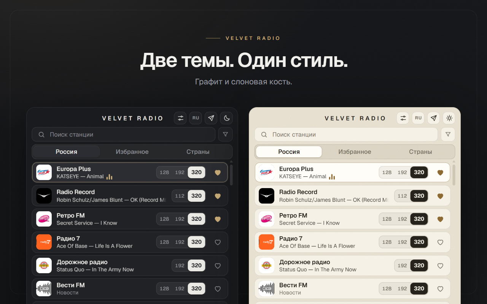
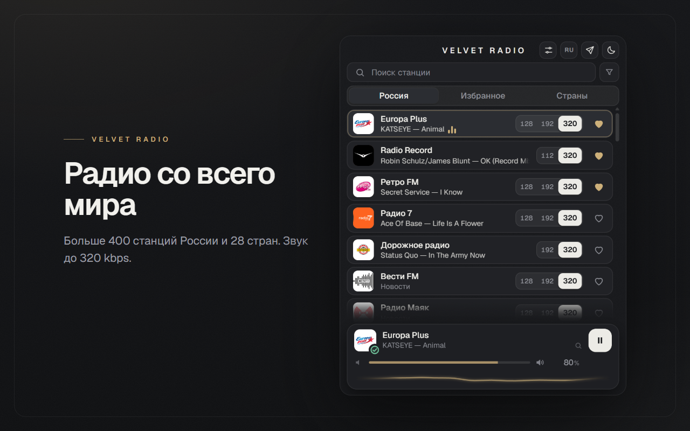
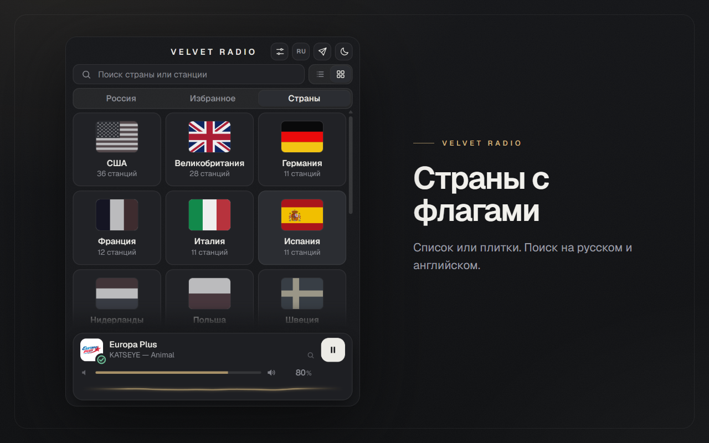
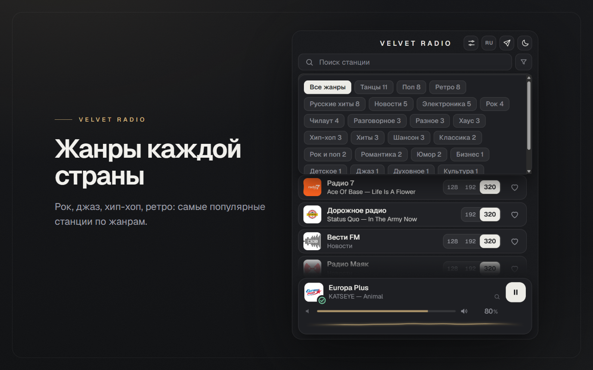
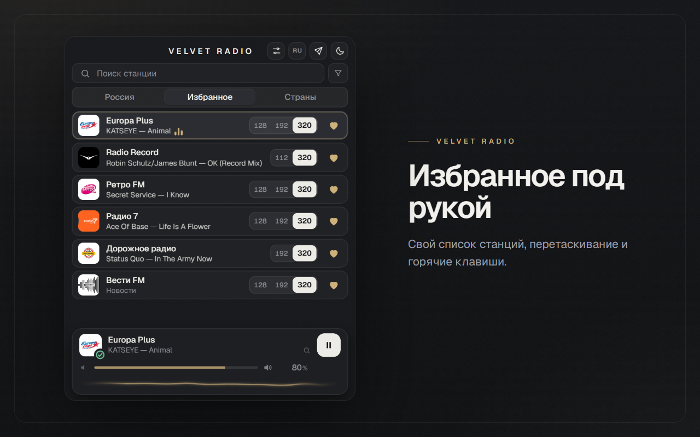
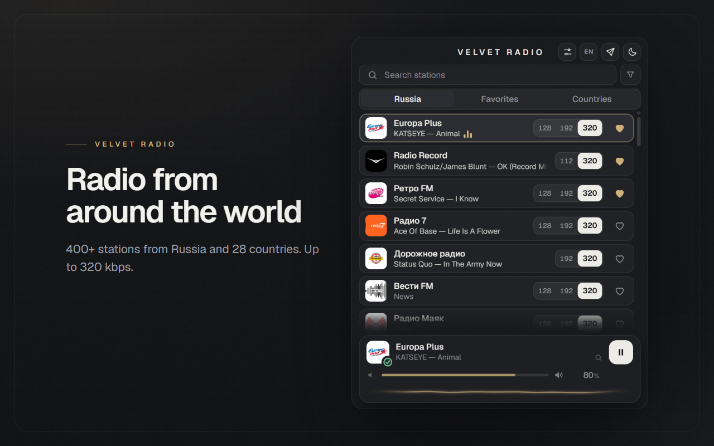
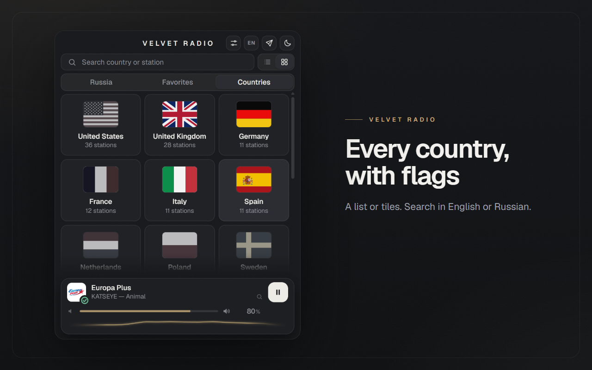
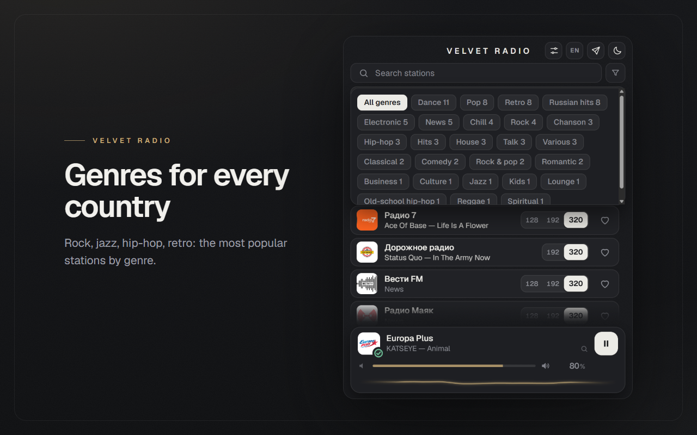
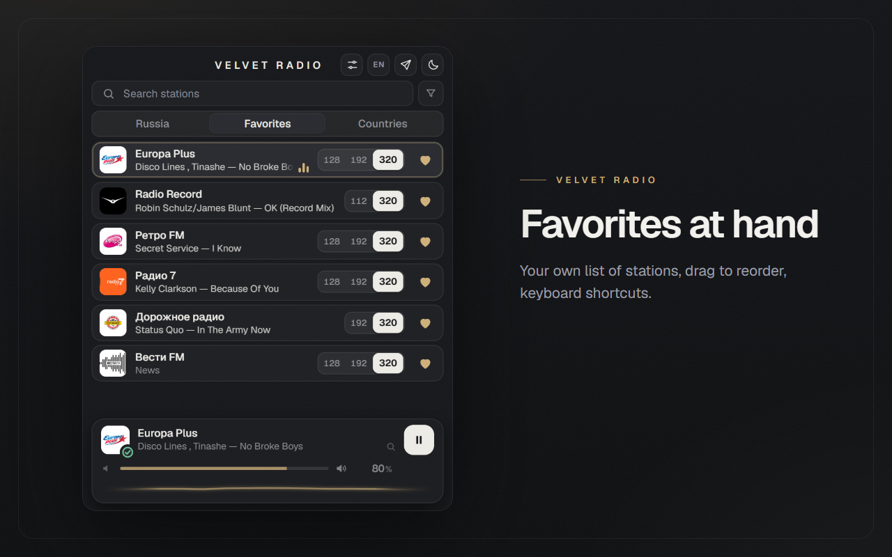

<div align="center">


# Velvet Radio

**Радио для Chrome, в котором всё продумано до мелочей.**

400+ станций России и 28 стран мира · звук до 320 kbps · строгий матовый интерфейс · играет в фоне

*A refined radio player for Chrome. 400+ stations from Russia and 28 countries, up to 320 kbps, a matte graphite-and-ivory interface, plays in the background.*




</div>

## Скриншоты

| | |
|---|---|
|  |  |
|  |  |

<details>
<summary>English screenshots</summary>

| | |
|---|---|
|  |  |
|  |  |

</details>

## Возможности

**Станции**
- **Россия и мир.** Вкладка «Россия» и вкладка «Страны» с флагами: список или плитки, поиск на русском и английском. У каждой страны свой набор жанров, у США и Великобритании станций больше.
- **Фильтр по жанрам**, избранное и перетаскивание станций в нужном порядке.
- **Название песни** у станций с открытым источником, в том числе прямо в списке. Клик по названию ищет песню в Google.

**Звук**
- **До 320 kbps.** Где станция отдаёт 128–320 kbps, переключатель качества стоит прямо в строке станции. Битрейт на кнопке заявленный, а сам поток проверяется на живое звучание.
- **Не молчит.** Если поток упал, расширение пробует резервные адреса, затем снижает качество и только потом сообщает, что станция недоступна.
- **Играет в фоне.** Закрыли окно, а музыка идёт. Плавные переходы между станциями; время ожидания перед стартом настраивается (4 / 9 / 14 секунд: чем дольше, тем реже заикается).
- **Визуализатор звука** там, где станция разрешает анализ. Его можно выключить: плеер станет ниже, и на экране поместится больше станций.

**Интерфейс**
- **Строгий матовый вид** в двух темах: графитовой («асфальт») и слоновой кости. Шрифт Geist. Классический интерфейс со стеклянными панелями остаётся доступным в настройках.
- **Тонкие анимации:** «набухающие» кнопки качества, резиновые вкладки и переключатели, громкость с упругим растяжением, эхо у надписи, табло с названием песни, стильные подсказки, плавный список при прокрутке. Анимации не работают, когда окно скрыто, и отключаются системной настройкой «уменьшить движение».
- **Значок в панели Chrome** в цветах интерфейса: пока станция подключается он «дышит», когда пошёл звук вспыхивает.
- Русский и английский интерфейс, переключатель в шапке.

**Управление и приватность**
- **Горячие клавиши и медиа-кнопки**: пауза, следующая и предыдущая станция с клавиатуры и наушников. В окне: `/` поиск, стрелки и `Enter`, `Esc`.
- **Настройки:** экономия трафика, запуск при старте Chrome, синхронизация избранного через аккаунт Chrome (по желанию), резервная копия.
- **Никакой аналитики, рекламы и слежки.** Весь код внутри расширения, ничего не подгружается из сети, новых разрешений нет.

## Что нового в 1.6

- Новый интерфейс по умолчанию: строгий матовый вид, две темы, шрифт Geist, анимации.
- Новый значок в панели Chrome с анимацией подключения.
- Настройка «Визуализатор звука» (выключить: плеер ниже, больше станций на экране).
- Настройка «Классический интерфейс» (прежний вид).

Подробно: [`CHANGELOG.md`](CHANGELOG.md).

## Станции

<!-- countries:start -->
| Страна | Станций |
|---|--:|
| Россия | 106 |
| США | 36 |
| Великобритания | 28 |
| Германия | 11 |
| Франция | 12 |
| Италия | 11 |
| Испания | 11 |
| Нидерланды | 11 |
| Польша | 10 |
| Швеция | 9 |
| Турция | 10 |
| Украина | 10 |
| Беларусь | 10 |
| Казахстан | 9 |
| Узбекистан | 5 |
| Армения | 10 |
| Азербайджан | 11 |
| Грузия | 9 |
| Китай | 5 |
| Япония | 10 |
| Республика Корея | 10 |
| Индия | 10 |
| ОАЭ | 9 |
| Камерун | 10 |
| Бразилия | 11 |
| Мексика | 10 |
| Аргентина | 11 |
| Канада | 11 |
| Австралия | 11 |
<!-- countries:end -->

Список станций хранится в `stations/<страна>.js`. Часть станций вещает из России и может быть недоступна за рубежом; зарубежные станции проверялись из России, закрытые по региону в каталог не входят. Названия песен есть не у всех станций: для новых источников нужны новые разрешения, а их расширение не запрашивает.

## Установка

Из Chrome Web Store: найдите **Velvet Radio** и нажмите «Установить». Для разработки или проверки версии из репозитория:

1. Скачайте репозиторий и откройте в Chrome `chrome://extensions`.
2. Включите **«Режим разработчика»** (справа вверху).
3. Нажмите **«Загрузить распакованное»** и выберите папку репозитория.
4. Нажмите значок пазла в панели Chrome и закрепите **Velvet Radio**.

## Горячие клавиши

| Действие | Сочетание по умолчанию |
|---|---|
| Пауза / продолжить | `Alt` + `Shift` + `P` |
| Следующая станция (в той же стране) | `Alt` + `Shift` + `→` |
| Предыдущая станция | `Alt` + `Shift` + `←` |

Изменить можно на `chrome://extensions/shortcuts`. Мультимедиа-кнопки клавиатуры и наушников тоже работают.

## Как это устроено

Расширение на **Manifest V3**, чистый JavaScript. Сборки нет: расширение загружается прямо из папки репозитория.

| Файл | Назначение |
|---|---|
| `stations/<страна>.js` | Каталог станций страны: качества, потоки, зеркала. `stations.js` из них **генерируется** (`node tools/gen-catalog.mjs`) |
| `offscreen.js` | Движок звука: быстрый старт, зеркала, автопереподключение, плавные переходы, визуализатор, MediaSession |
| `background.js` | Состояние, значок и его анимация, горячие клавиши, автозапуск |
| `nowplaying.js` | Источники названий песен |
| `popup.html/css/js`, `i18n.js`, `settings.js` | Окно расширения, переводы (ru/en), настройки, резервная копия, синхронизация |
| `popup-v2.css`, `ui/` | Новый интерфейс: тема и анимированные элементы. `ui/ui.css` **генерируется** из `ui/*.css` (`node tools/gen-ui.mjs`) |
| `boot.js` | Применяет вид и тему до первой отрисовки, чтобы окно не мигало |
| `flags/` | Флаги стран ([flag-icons](https://github.com/lipis/flag-icons), MIT) |
| `vendor/` | [hls.js](https://github.com/video-dev/hls.js) для потоков HLS и шрифт [Geist](https://vercel.com/font) (SIL OFL). Лежат внутри, из сети не подгружаются |
| `tools/` | Инструменты разработки: проверка потоков, скрытые тесты, значки и графика магазина (в расширение не входят) |

Звук играет в скрытом документе (`offscreen`), поэтому не прерывается при закрытии окна. Стили нового вида привязаны к `data-ui="new"`, поэтому классический вид (`popup.css`) остаётся прежним.

## Разработка

```bash
cd tools && npm install             # один раз: Playwright для скрытых проверок
node tools/gen-catalog.mjs          # пересобрать stations.js из stations/*.js
node tools/gen-ui.mjs               # пересобрать ui/ui.css после правки ui/*.css
node tools/check-catalog.mjs --live # проверка схемы каталога и всех адресов потоков
node tools/test-ui-v2.mjs out       # скрытая проверка нового вида (без звука и окон)
node tools/test-playback.mjs        # скрытый тест воспроизведения
python tools/build.py               # собрать архив для Chrome Web Store (dist/)
```

Все проверки идут в скрытом браузере без звука: можно спокойно играть в это время. Правила добавления станций: [`ADDING-STATIONS.md`](ADDING-STATIONS.md). План: [`ROADMAP.md`](ROADMAP.md).

Нашли станцию, которая не играет? Нажмите «Сообщить о проблеме» в окне расширения или откройте [issue](../../issues/new/choose): потоки иногда меняются, и их нужно обновлять.

## Важно знать

- **Неофициальный проект.** Названия и логотипы станций принадлежат их владельцам и используются только для узнавания. Расширение лишь проигрывает общедоступные потоки.
- **Потоки могут меняться.** Станция вправе закрыть или переименовать поток. Для этого есть резервные адреса, автоматическое снижение качества и проверка избранных станций.
- **Битрейт на кнопке заявленный.** Название потока иногда врёт (например, «320k» на деле 128), и мы это знаем: цифра берётся из плеера станции или каталога, но сам поток обязательно проверяется на живое аудио.

## English

**Velvet Radio** is a Chrome extension for internet radio (Manifest V3, plain JavaScript, no build step).

- 400+ stations from Russia and 28 countries, with flags, per-country genres, search in English and Russian.
- Up to 320 kbps, per-station quality switch, automatic failover to backup streams and lower quality.
- Plays in the background (hidden offscreen document), crossfades between stations, song titles where available.
- A matte interface in two themes, graphite and ivory, with subtle animations; the classic glass interface is one switch away in Settings. The sound visualizer can be turned off to fit more stations on screen.
- No analytics, ads or tracking. All code lives inside the extension; no remote code and no new permissions.

To try it from this repository: open `chrome://extensions`, enable Developer mode, choose **Load unpacked** and select the repository folder.

## Автор и благодарности

Сделано одним человеком с помощью ИИ. Вопросы и предложения: [Telegram @sushtrsx](https://t.me/sushtrsx).

Спасибо открытым проектам: [React Bits](https://reactbits.dev) (идеи и поведение анимированных элементов, перенесены на чистый JS и CSS, лицензия и уведомление в [`THIRD_PARTY_NOTICES.md`](THIRD_PARTY_NOTICES.md)), [Geist](https://vercel.com/font), [hls.js](https://github.com/video-dev/hls.js), [flag-icons](https://github.com/lipis/flag-icons).

## Лицензия

[MIT](LICENSE). Сторонние компоненты: [`THIRD_PARTY_NOTICES.md`](THIRD_PARTY_NOTICES.md), флаги: [`flags/LICENSE`](flags/LICENSE).
